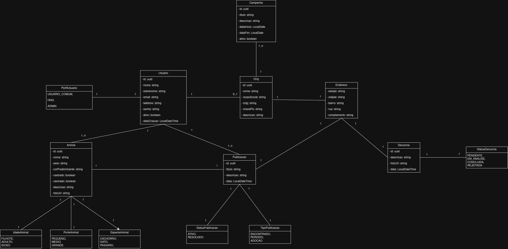
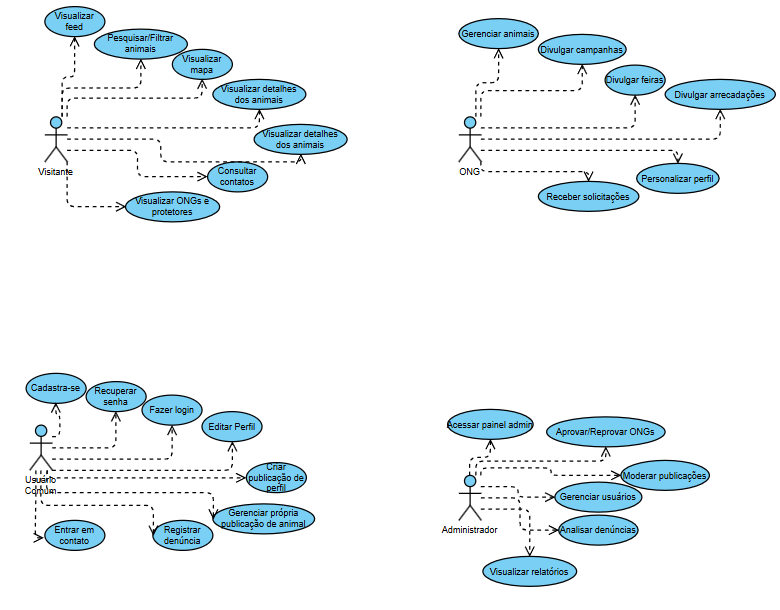

# 📐 Diagramas UML — Pet Ajuda

> **Ferramenta de Origem:** Draw.io

## 📄 1. Diagrama de Classes UML

O Diagrama de Classes descreve a estrutura estática do sistema, mapeando as entidades, enumeradores, atributos e relacionamentos do modelo de dados.

### 📊 Visualização em Mermaid (Renderizado no Obsidian)

```
classDiagram
    direction TB

    class PerfilUsuario {
        <<enumeration>>
        USUARIO_COMUM
        ONG
        ADMIN
    }

    class Usuario {
        +UUID id
        +String nome
        +String sobrenome
        +String email
        +String telefone
        +String senha
        +Boolean ativo
        +LocalDateTime dataCriacao
    }

    class Ong {
        +UUID id
        +String nome
        +String razaoSocial
        +String cnpj
        +String chavePix
        +String descricao
    }

    class Animal {
        +UUID id
        +String nome
        +String sexo
        +String corPredominante
        +Boolean castrado
        +Boolean vacinado
        +String descricao
        +String fotoUrl
    }

    class IdadeAnimal {
        <<enumeration>>
        FILHOTE
        ADULTO
        IDOSO
    }

    class PorteAnimal {
        <<enumeration>>
        PEQUENO
        MEDIO
        GRANDE
    }

    class EspecieAnimal {
        <<enumeration>>
        CACHORRO
        GATO
        PASSARO
    }

    class Publicacao {
        +UUID id
        +String titulo
        +String descricao
        +LocalDateTime data
    }

    class StatusPublicacao {
        <<enumeration>>
        ATIVO
        RESOLVIDO
    }

    class TipoPublicacao {
        <<enumeration>>
        ENCONTRADO
        PERDIDO
        ADOCAO
    }

    class Denuncia {
        +UUID id
        +String descricao
        +String fotoUrl
        +LocalDateTime data
    }

    class StatusDenuncia {
        <<enumeration>>
        PENDENTE
        EM_ANALISE
        CONCLUIDA
        REJEITADA
    }

    class Campanha {
        +UUID id
        +String titulo
        +String descricao
        +LocalDate dataInicio
        +LocalDate dataFim
        +Boolean ativo
    }

    class Endereco {
        +String estado
        +String cidade
        +String bairro
        +String rua
        +String complemento
    }

    %% Relacionamentos
    Usuario "1" -- "1" PerfilUsuario
    Usuario "1" -- "0..1" Ong
    Usuario "1" -- "1..n" Animal
    Usuario "1" -- "1..n" Publicacao
    
    Ong "1" -- "1..n" Campanha
    Ong "1" -- "1" Endereco
    
    Publicacao "1" -- "1" Animal
    Publicacao "1" -- "1" StatusPublicacao
    Publicacao "1" -- "1" TipoPublicacao
    Publicacao "1" -- "1" Endereco
    
    Animal "1" -- "1" IdadeAnimal
    Animal "1" -- "1" PorteAnimal
    Animal "1" -- "1" EspecieAnimal

    Denuncia "1" -- "1" StatusDenuncia
    Denuncia "1" -- "1" Endereco
```



### 🗂️ Mapeamento de Entidades e Atributos

|   |   |   |
|---|---|---|
|**Entidade**|**Atributos Principais**|**Tipos**|
|**`Usuario`**|`id`, `nome`, `sobrenome`, `email`, `telefone`, `senha`, `ativo`, `dataCriacao`|`UUID`, `String`, `Boolean`, `LocalDateTime`|
|**`Ong`**|`id`, `nome`, `razaoSocial`, `cnpj`, `chavePix`, `descricao`|`UUID`, `String`|
|**`Animal`**|`id`, `nome`, `sexo`, `corPredominante`, `castrado`, `vacinado`, `descricao`, `fotoUrl`|`UUID`, `String`, `Boolean`|
|**`Publicacao`**|`id`, `titulo`, `descricao`, `data`|`UUID`, `String`, `LocalDateTime`|
|**`Denuncia`**|`id`, `descricao`, `fotoUrl`, `data`|`UUID`, `String`, `LocalDateTime`|
|**`Campanha`**|`id`, `titulo`, `descricao`, `dataInicio`, `dataFim`, `ativo`|`UUID`, `String`, `LocalDate`, `Boolean`|
|**`Endereco`**|`estado`, `cidade`, `bairro`, `rua`, `complemento`|`String` (Objeto Embutido)|

### 🏷️ Enumeradores (Enums)

- **`PerfilUsuario`:** `USUARIO_COMUM`, `ONG`, `ADMIN`
    
- **`EspecieAnimal`:** `CACHORRO`, `GATO`, `PASSARO`
    
- **`PorteAnimal`:** `PEQUENO`, `MEDIO`, `GRANDE`
    
- **`IdadeAnimal`:** `FILHOTE`, `ADULTO`, `IDOSO`
    
- **`TipoPublicacao`:** `ENCONTRADO`, `PERDIDO`, `ADOCAO`
    
- **`StatusPublicacao`:** `ATIVO`, `RESOLVIDO`

- **`StatusDenuncia`:** `PENDENTE`, `EM_ANALISE`, `CONCLUIDA`, `REJEITADA`
    

## 🎯 2. Diagrama de Casos de Uso UML

O Diagrama de Casos de Uso define as interações funcionais do sistema a partir da perspectiva de cada ator.

### 👥 Mapeamento por Ator

#### 🌐 1. Visitante

- Visualizar feed
- Pesquisar/Filtrar animais
- Visualizar mapa
- Visualizar detalhes dos animais
- Consultar contatos
- Visualizar ONGs e protetores
    

#### 👤 2. Usuário Comum

- Cadastrar-se
- Fazer login
- Recuperar senha
- Editar Perfil
- Criar publicação de animal
- Gerenciar própria publicação de animal
- Registrar denúncia (Anônima)
- Entrar em contato com anunciantes
    

#### 🐾 3. ONG / Protetor

- Gerenciar animais
- Divulgar campanhas
- Divulgar feiras
- Divulgar arrecadações
- Personalizar perfil
- Receber solicitações de adoção/contato
    

#### 🛡️ 4. Administrador

- Acessar painel admin
- Aprovar/Reprovar ONGs
- Moderar publicações
- Gerenciar usuários
- Analisar denúncias
- Visualizar relatórios do sistema
    



